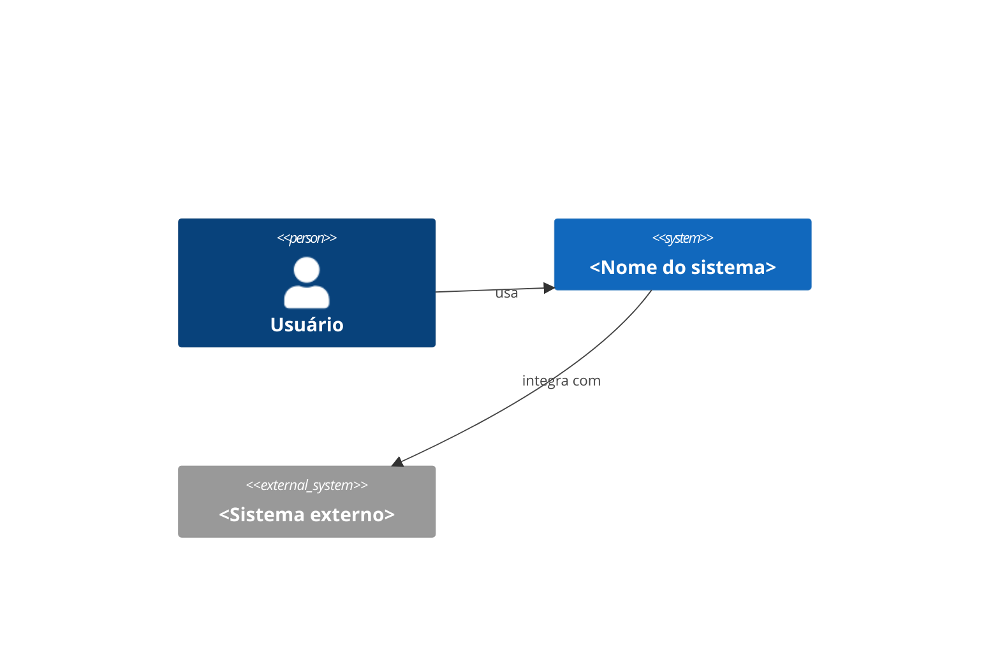

# HLD: <Nome do sistema>

## Visão geral
O que o sistema faz e qual problema resolve, em poucas linhas.

## Requisitos que orientam a arquitetura
Resumo dos requisitos, principalmente não funcionais, com link para o PRD.

## Contexto do sistema
Diagrama C4 nível 1: sistema, usuários e sistemas externos.

## Componentes principais
| Componente | Responsabilidade | Tecnologia | Doc detalhado |
|---|---|---|---|
| ... | ... | ... | link para o LLD |

## Fluxos principais
Diagrama de sequência dos cenários mais importantes.

## Dados
Entidades centrais, onde ficam armazenadas e como fluem.

## Integrações externas
APIs, filas, serviços de terceiros.

## Atributos de qualidade
Como a arquitetura atende escalabilidade, disponibilidade, segurança e observabilidade.

## Decisões arquiteturais
Lista dos ADRs relevantes com link.

## Riscos e pontos de atenção
- ...
