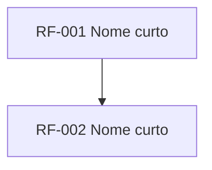

# Roadmap: <Produto>

## Como ler este documento
- **Agora**: em execução ou com compromisso firmado para o ciclo atual.
- **Próximo**: priorizado, com PRD em andamento. A ordem pode mudar.
- **Depois**: direção de intenção, sem compromisso de data.
- Itens sem link para PRD ou FDD são ideias, não compromissos.
- Revisado mensalmente. Fora disso, apenas o status dos itens é atualizado.
- "Ordem de execução" é derivada da tabela de dependências do PRD e regenerada por script; não é editada à mão.

## Objetivos do período
| Objetivo | Métrica | Hoje | Meta |
|---|---|---|---|
| ... | ... | ... | ... |

## Ordem de execução

Requisitos na mesma onda podem ser construídos em paralelo. Uma onda começa só depois que todos os requisitos das ondas anteriores estão prontos. Gerado por `python3 .claude/skills/docs-init/scripts/prd_checks.py <prd> --ondas`.

### [PRD: nome](prd-nome.md)

- **Onda 1**: RF-001
- **Onda 2**: RF-002

Caminho crítico: RF-001 > RF-002 (2 ondas).

## Agora
| Iniciativa | Requisitos | Objetivo | Status | Docs | Owner |
|---|---|---|---|---|---|

## Próximo
| Iniciativa | Requisitos | Objetivo | Status | Docs |
|---|---|---|---|---|

## Depois
- ...

## Concluído
| Iniciativa | Entregue em | Docs |
|---|---|---|

## Adiado ou removido
| Iniciativa | Decisão | Motivo | Data |
|---|---|---|---|

## Histórico de mudanças
| Data | Mudança | Por quem |
|---|---|---|
