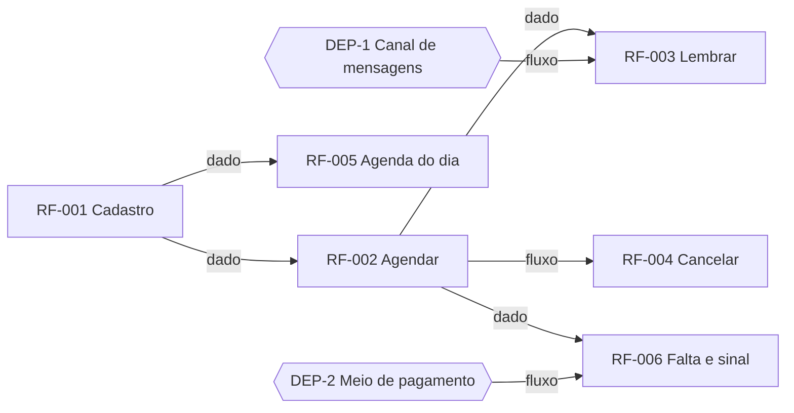

# PRD: Agendamento para barbearias

Versão: 0.2.0
Data: 2026-10-18
Responsável: Maicon Souza

---

## Resumo

Sistema de agendamento para barbearias pequenas (1 a 5 cadeiras). O dono cadastra serviços e barbeiros, o cliente marca pelo celular sem instalar nada, o sistema lembra o cliente e trata faltas. Objetivo: reduzir não-comparecimento pela metade em 3 meses e tirar o dono do WhatsApp.

---

## Contexto e problema

Público-alvo
- Dono da barbearia: administra serviços, barbeiros e agenda
- Barbeiro: vê a própria agenda do dia
- Cliente final: marca, cancela e remarca pelo celular

Cenários de uso chave
- Cliente escolhe serviço, barbeiro e horário livre e confirma com nome e telefone
- Dono marca manualmente um cliente que ligou
- Sistema lembra o cliente 24h e 2h antes

Contexto de implantação
- Substitui agenda de papel e marcação por mensagem

Problemas priorizados
- 8 a 10 horários perdidos por semana por desencontro e falta. Prioridade: alta
- Dono gasta 1 hora por dia respondendo mensagens. Prioridade: alta

---

## Objetivos e métricas

| Objetivo | Métrica | Meta |
| --- | --- | --- |
| Reduzir não-comparecimento | faltas por semana | metade em 3 meses |
| Tirar o dono do WhatsApp | horas por dia em mensagens | abaixo de 15 minutos em 3 meses |

---

## Escopo

Incluso
- Cadastro, agendamento pelo cliente, lembretes, cancelamento, agenda do dia, faltas e sinal

Fora de escopo
- Pagamento online do serviço inteiro, fidelidade, app nativo, múltiplas unidades

---

## Requisitos funcionais

### RF-001 Cadastrar barbearia, serviços e barbeiros
O dono cadastra a barbearia, os serviços (nome, duração, preço) e os barbeiros com horário de trabalho.

**Fluxo principal**
- Dono cria a barbearia
- Dono adiciona serviços com duração e preço
- Dono adiciona barbeiros com dias e horários de trabalho

**Fluxos alternativos e exceções**
- Barbeiro inativado mantém histórico

**Erros previstos**
- Duração zero ou preço negativo bloqueiam o cadastro

**Prioridade:** alta

---

### RF-002 Agendar horário pelo cliente
O cliente escolhe serviço, barbeiro (ou qualquer) e horário livre e confirma com nome e telefone.

**Fluxo principal**
- Cliente abre o link da barbearia
- Escolhe serviço e barbeiro ou "qualquer"
- Vê horários livres e escolhe um
- Confirma com nome e telefone
- Recebe confirmação

**Fluxos alternativos e exceções**
- "Qualquer barbeiro" aloca o primeiro livre

**Erros previstos**
- Horário ocupado entre a escolha e a confirmação retorna erro e lista de novo

**Prioridade:** alta

---

### RF-003 Lembrar o cliente
O sistema envia lembrete 24h e 2h antes com opção de cancelar.

**Fluxo principal**
- Sistema identifica agendamentos nas janelas de 24h e 2h
- Envia mensagem pelo canal do cliente
- Registra envio e resposta

**Fluxos alternativos e exceções**
- Canal indisponível: tenta de novo até 3 vezes

**Erros previstos**
- Telefone inválido marca o agendamento para contato manual

**Prioridade:** alta

---

### RF-004 Cancelar ou remarcar
O cliente cancela ou remarca até 2h antes do horário.

**Fluxo principal**
- Cliente abre o link do agendamento
- Escolhe cancelar ou remarcar
- Sistema libera o horário e confirma

**Fluxos alternativos e exceções**
- Remarcação segue o fluxo de RF-002

**Erros previstos**
- Menos de 2h antes: bloqueia e orienta a ligar

**Prioridade:** media

---

### RF-005 Agenda do dia e marcação manual
O dono vê a agenda do dia de todos os barbeiros e marca manualmente.

**Fluxo principal**
- Dono abre a agenda do dia
- Vê horários por barbeiro
- Marca um horário manualmente com nome e telefone

**Fluxos alternativos e exceções**
- Barbeiro vê só a própria agenda

**Erros previstos**
- Conflito de horário bloqueia a marcação

**Prioridade:** alta

---

### RF-006 Registrar falta e exigir sinal
O dono marca não-comparecimento; após 2 faltas em 60 dias o cliente só agenda pagando sinal.

**Fluxo principal**
- Dono marca falta no agendamento
- Sistema conta faltas em 60 dias por telefone
- Na terceira tentativa de agendar, exige sinal antes de confirmar

**Fluxos alternativos e exceções**
- Dono pode perdoar uma falta

**Erros previstos**
- Sinal não pago em 15 minutos libera o horário

**Prioridade:** media

---

## Requisitos não funcionais

Performance
- Lista de horários livres responde em até 1 segundo para 95 por cento das consultas

Disponibilidade
- 99.5 por cento mensal (hipótese)

Segurança e autorização
- Dono, barbeiro e cliente veem só o que lhes cabe; telefone é dado pessoal

Auditoria e rastreabilidade
- Toda falta registrada tem autor e horário

Compliance
- Dados pessoais conforme a LGPD, exclusão sob pedido

---

## Decisões de produto e trade-offs

### Decisão: sinal após 2 faltas em 60 dias
- **Justificativa:** reduz falta reincidente
- **Trade-off:** pode afastar cliente ocasional

---

## Dependências

### externa: canal de mensagens
Serviço de mensagens que entrega o lembrete no celular do cliente e recebe a resposta.

### externa: meio de pagamento do sinal
Serviço que cobra o sinal e confirma o pagamento.

---

## Riscos e mitigação

### Cliente não responde ao lembrete
- **Probabilidade:** media
- **Impacto:** falta continua
- **Mitigação:**
  - Segundo canal
- **Plano de contingência:** dono liga

---

## Critérios de aceitação

- Cliente agenda em menos de 1 minuto sem instalar nada
- Lembrete chega 24h e 2h antes

---

## Validação

Tipos de validação obrigatórios
- Testes das regras de conflito de horário e de faltas

Estratégia de validação
- Piloto em uma barbearia por 4 semanas

---

## Mapa de dependências e paralelismo

| Onda | Requisitos (paralelos entre si) | Depende de |
| --- | --- | --- |
| 1 | RF-001 | nenhum |
| 2 | RF-002, RF-005 | RF-001 |
| 3 | RF-003, RF-004, RF-006 | RF-002, DEP-1, DEP-2 |

Caminho crítico: RF-001 → RF-002 → RF-003 (3 ondas).
