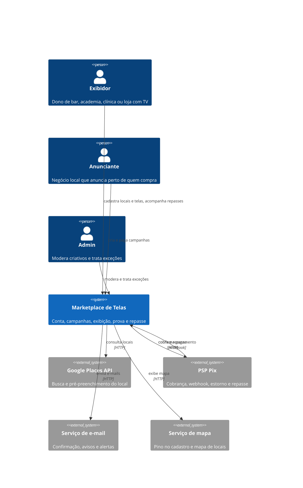
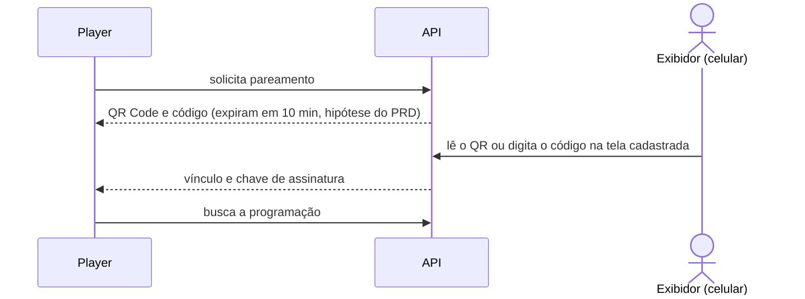
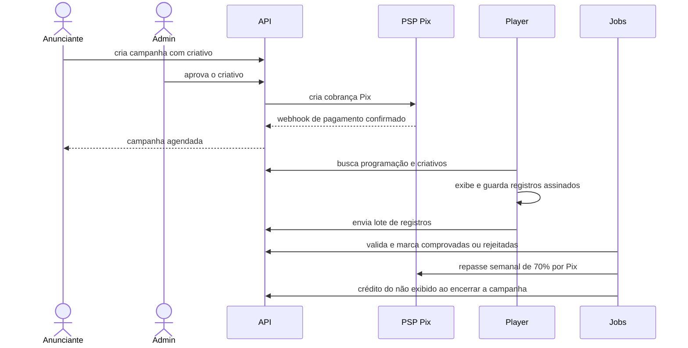

# HLD: Marketplace de Telas

Nome de trabalho. [A CONFIRMAR: qual é o nome do produto?]

## Visão geral

O Marketplace de Telas é um marketplace de mídia digital em TVs de estabelecimentos comerciais. O exibidor (bar, academia, clínica, loja) cadastra o local e as telas. O anunciante local cria uma campanha com um criativo e paga por Pix. A plataforma retém 30% e repassa 70% ao exibidor, proporcional ao que foi exibido de verdade.

Uma conta única serve para anunciar e para exibir. Um admin da plataforma modera criativos e trata exceções de pagamento e repasse.

Estágio: ideia, rumo ao MVP. Não há código do produto neste repositório. Tudo abaixo vem da entrevista de 2026-10-21 (`../_intake/entrevista-2026-10-21.md`). Nada foi inferido de código.

## Requisitos que orientam a arquitetura

O PRD é o [PRD: Marketplace de Telas](../product/prd-marketplace-de-telas.md). Os itens abaixo são os que mais pesam na arquitetura.

Requisitos não funcionais:

- Disponibilidade do player: exibe a partir de cache offline quando a internet cai (RF-007).
- Desempenho da web: [A CONFIRMAR: quantos segundos o usuário tolera esperar?]
- Disponibilidade da plataforma: [A CONFIRMAR: qual % ou janela de indisponibilidade é aceitável?]
- Acesso: cada conta vê só os seus locais, telas, campanhas e repasses. O admin vê tudo.
- Dispositivos: web responsiva para conta e admin, e player na TV. [A CONFIRMAR: o player roda em Android TV, Smart TV ou navegador?]
- Idioma: pt-BR.
- Norma: LGPD (dados pessoais, CPF/CNPJ e chave Pix). [A CONFIRMAR: quais conteúdos exibidos em local público são vetados?]
- Restrição: pagamento só via Pix.

Requisitos funcionais que mais pesam:

| RF | Peso na arquitetura |
|---|---|
| RF-001 | Fundação: conta única e papéis. Todos os outros dependem dele. |
| RF-002 | Integração com Google Places e serviço de mapa. |
| RF-003 | Pareamento do player por QR Code e código; chave de assinatura do player. |
| RF-006 | Integração com PSP Pix (cobrança, webhook, estorno). |
| RF-007 | Player com cache offline e sincronização da programação a cada 15 min (hipótese do PRD). |
| RF-008 | Registro de exibição assinado pelo player, enviado em lote, validado por job. |
| RF-009 | Fechamento semanal e pagamento de repasse por Pix, sem interação direta. |
| RF-012 | Crédito do não exibido gerado por job no fim da campanha. |

Processamento sem interação direta: validação de exibições, fechamento semanal de repasse e crédito no fim da campanha rodam em jobs agendados.

## Contexto do sistema

Apenas o que foi confirmado na entrevista. O PSP Pix, o serviço de e-mail e o serviço de mapa ainda não têm fornecedor escolhido. O frequentador (RF-011) é visão de longo prazo e não entra no diagrama.

## Componentes principais

Arquitetura proposta (ADR ainda `proposed`): monólito modular com player separado ([ADR-0020](../adr/0020-adotar-monolito-modular-com-player-separado.md)). Não há código no repositório, então todos os componentes vêm da entrevista. Onde cada um vive no repositório ainda não está definido.

| Componente | Responsabilidade | Tecnologia | Doc detalhado |
|---|---|---|---|
| Web (conta e admin) | Interface responsiva com as áreas Anunciar, Exibir e Admin. SPA ou SSR. | [A CONFIRMAR: qual framework e onde vive no repositório?] | [A CONFIRMAR: LLD ainda não criado] |
| API/backend (monólito modular) | Expõe REST por HTTPS para web e player. Contém os módulos abaixo. | [A CONFIRMAR: linguagem e framework?] | [A CONFIRMAR: LLD ainda não criado] |
| Módulo contas | Cadastro, login, papéis (exibidor, anunciante, admin) e conta única. | Parte da API | [A CONFIRMAR: LLD ainda não criado] |
| Módulo locais e telas | Cadastro de local e tela, preço por inserção, pausa, pareamento do player. | Parte da API | [A CONFIRMAR: LLD ainda não criado] |
| Módulo campanhas | Campanha, criativos por orientação, período, frequência, preço gravado. | Parte da API | [A CONFIRMAR: LLD ainda não criado] |
| Módulo moderação | Fila e decisão do admin sobre criativos. | Parte da API | [A CONFIRMAR: LLD ainda não criado] |
| Módulo pagamentos | Cobrança Pix, webhook do PSP, estorno e uso de crédito. | Parte da API | [A CONFIRMAR: LLD ainda não criado] |
| Módulo exibições | Recebe lotes assinados do player e aplica regras de validação. | Parte da API | [A CONFIRMAR: LLD ainda não criado] |
| Módulo repasses e crédito | Fechamento semanal, extrato, repasse Pix e crédito do não exibido. | Parte da API | [A CONFIRMAR: LLD ainda não criado] |
| Player na TV | Baixa a programação, mantém cache offline, exibe, assina e envia registros. | [A CONFIRMAR: app Android TV, app Smart TV ou página no navegador?] | [A CONFIRMAR: LLD ainda não criado] |
| Jobs agendados | Validação de exibições, fechamento semanal de repasse, crédito no fim da campanha. Leem o mesmo banco. | [A CONFIRMAR: qual mecanismo de agendamento?] | [A CONFIRMAR: LLD ainda não criado] |
| Banco relacional | Guarda dinheiro e estados. | [A CONFIRMAR: qual banco?] | [A CONFIRMAR: LLD ainda não criado] |
| Storage de objetos com CDN | Guarda e distribui os criativos. | [A CONFIRMAR: qual cloud e provedor de CDN?] | [A CONFIRMAR: LLD ainda não criado] |

Componentes encontrados no código que não estavam na entrevista: nenhum. O repositório só tem o harness do template.

## Fluxos principais

Pareamento do player (RF-003, [ADR-0016](../adr/0016-parear-o-player-por-qr-code-e-por-codigo.md)):

Da campanha ao repasse (RF-004 a RF-009 e RF-012):

## Dados

Entidades centrais, derivadas dos contratos do PRD. Modelo detalhado ainda não existe. [A CONFIRMAR: onde fica o modelo de dados detalhado?]

| Entidade | Fornecida por | Observação |
|---|---|---|
| Conta e papel | RF-001 | Conta única; admin atribuído por outro admin. |
| Local e Tela | RF-002 | Tela com orientação, horário ligada, preço por inserção e status. |
| Vínculo do player | RF-003 | Player, tela, chave de assinatura, status online. |
| Campanha | RF-004 | Criativos por orientação, preço por tela gravado na compra, estado. |
| Aprovação | RF-005 | Campanha, decisão, motivo. |
| Pagamento | RF-006 | Valor pago, data, estado. |
| Inserção exibida | RF-007 | Registro do player. |
| Exibição comprovada | RF-008 | Comprovada ou rejeitada, com motivo. |
| Repasse | RF-009 | Fechamento semanal, extrato por tela e campanha. |
| Crédito | RF-012 | Saldo da conta e campanha de origem. |

Onde ficam:

- Banco relacional: dinheiro, estados, contas, campanhas, exibições e repasses.
- Storage de objetos: arquivos de criativo, servidos por CDN.
- Cache local do player: programação e criativos das próximas 24 h (hipótese do PRD) e registros de exibição pendentes, por até 7 dias (hipótese do PRD).

Como fluem: o player envia registros assinados em lote para a API. Os jobs leem o mesmo banco, validam e produzem exibições comprovadas. Dessas saem o repasse e o crédito.

Retenção de dados e detalhes de LGPD: [A CONFIRMAR: por quanto tempo cada dado é retido e qual a base legal?]

## Integrações externas

| Integração | Uso | Protocolo | Trava |
|---|---|---|---|
| Google Places API | Busca e pré-preenchimento do local ([ADR-0012](../adr/0012-usar-google-places-api-para-pre-preencher-o-local.md)) | HTTP, da API para o serviço | RF-002 |
| PSP Pix | Cobrança, confirmação por webhook, estorno e pagamento de repasse ([ADR-0021](../adr/0021-aceitar-so-pix-como-pagamento.md)) | HTTP e webhook para a API | RF-006, RF-009, RF-012 |
| Serviço de e-mail | Confirmação, avisos de moderação e alertas | HTTP | RF-001, RF-005, RF-010 |
| Serviço de mapa | Pino no cadastro e mapa de locais | HTTP | RF-002, RF-011 |

Lacunas:

- [A CONFIRMAR: qual PSP ou banco processa o Pix?]
- [A CONFIRMAR: reter e repassar exige split do PSP ou licença de subcredenciador?]
- [A CONFIRMAR: qual serviço de e-mail?]
- [A CONFIRMAR: qual serviço de mapa?]

Comunicação interna: web e player falam com a API por HTTPS (REST). Os jobs acessam o mesmo banco.

## Atributos de qualidade

- Escalabilidade: o monólito modular atende o MVP com time pequeno. Metas de carga: [A CONFIRMAR: quantas telas e campanhas o MVP deve suportar?]
- Disponibilidade: o player segue exibindo o cache sem internet ([ADR-0017](../adr/0017-adotar-cache-offline-no-player.md)). Meta para a plataforma: [A CONFIRMAR: qual % ou janela de indisponibilidade é aceitável?]
- Desempenho: [A CONFIRMAR: quantos segundos o usuário tolera esperar na web?]
- Segurança: cada conta vê só os seus dados. Registros de exibição são assinados pelo player ([ADR-0018](../adr/0018-comprovar-a-exibicao-por-registro-assinado-do-player.md)). Lote com assinatura inválida é rejeitado. Autenticação técnica: [A CONFIRMAR: qual mecanismo de sessão ou token?]
- Privacidade: LGPD sobre CPF/CNPJ e chave Pix. CPF/CNPJ só é pedido no primeiro pagamento e no primeiro repasse. Detalhes: [A CONFIRMAR: quais controles de LGPD são exigidos?]
- Consistência financeira: dinheiro e estados ficam no banco relacional. O preço da tela é gravado na campanha na compra.
- Observabilidade: [A CONFIRMAR: quais logs, métricas e alertas são exigidos?]
- Deploy: [A CONFIRMAR: onde e como o sistema é implantado?]

## Decisões arquiteturais

ADRs do produto, todos `proposed`. ADR estrutural é o que mais pesa aqui.

- [ADR-0010](../adr/0010-usar-conta-unica-para-anunciar-e-exibir.md): conta única para anunciar e exibir
- [ADR-0011](../adr/0011-repassar-70-ao-exibidor-pelo-exibido.md): repasse proporcional ao exibido
- [ADR-0012](../adr/0012-usar-google-places-api-para-pre-preencher-o-local.md): Google Places para pré-preencher o cadastro de local
- [ADR-0013](../adr/0013-deixar-o-exibidor-definir-o-preco-por-insercao.md): preço por inserção definido pelo exibidor, com piso da plataforma
- [ADR-0014](../adr/0014-adotar-moderacao-humana-do-criativo-antes-do-pagamento.md): moderação humana do criativo antes do pagamento
- [ADR-0015](../adr/0015-converter-o-valor-nao-exibido-em-credito.md): crédito do valor não exibido
- [ADR-0016](../adr/0016-parear-o-player-por-qr-code-e-por-codigo.md): pareamento do player por QR Code e código
- [ADR-0017](../adr/0017-adotar-cache-offline-no-player.md): player com cache offline
- [ADR-0018](../adr/0018-comprovar-a-exibicao-por-registro-assinado-do-player.md): prova de exibição por registro assinado
- [ADR-0019](../adr/0019-adotar-repasse-semanal.md): repasse semanal
- [ADR-0020](../adr/0020-adotar-monolito-modular-com-player-separado.md): monólito modular com player separado
- [ADR-0021](../adr/0021-aceitar-so-pix-como-pagamento.md): pagamento só via Pix

Escolhas de stack (linguagem, framework, banco, cloud, PSP) não foram decididas e ainda não têm candidato a ADR.

## Riscos e pontos de atenção

- Plataforma do player indefinida. Ela afeta cache offline, assinatura e pareamento. [A CONFIRMAR: o player roda em Android TV, Smart TV ou navegador?]
- Reter e repassar dinheiro de terceiros pode exigir split do PSP ou licença. Isso pode mudar a arquitetura de pagamentos. [A CONFIRMAR: reter e repassar exige split do PSP ou licença de subcredenciador?]
- Prova de exibição só garante que o player exibiu, não que a TV estava ligada. [A CONFIRMAR: como provar que a TV estava ligada, e não só o player?]
- Relógio do player pode estar errado. A regra aceita é usar a hora do servidor no envio.
- Wi-fi instável nos locais. O cache offline reduz o impacto, mas registros pendentes podem passar de 7 dias e serem descartados (hipótese do PRD).
- Dependência de serviços externos (Places, PSP, e-mail, mapa) sem fornecedor definido, exceto o Google Places.
- Conteúdo exibido em local público de terceiros. Regras de conteúdo vetado ainda indefinidas. [A CONFIRMAR: quais são as regras de conteúdo vetado?]
- Stack, deploy e observabilidade não decididos. O MVP não pode começar a ser construído sem eles.
