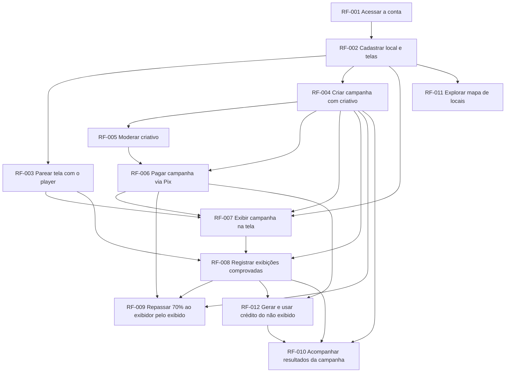

# Roadmap: Marketplace de Telas

## Como ler este documento
- **Agora**: em execução ou com compromisso firmado para o ciclo atual.
- **Próximo**: priorizado, com PRD em andamento. A ordem pode mudar.
- **Depois**: direção de intenção, sem compromisso de data.
- Itens sem link para PRD ou FDD são ideias, não compromissos.
- Revisado mensalmente. Fora disso, apenas o status dos itens é atualizado.
- "Ordem de execução" é derivada da tabela de dependências do PRD e regenerada por script; não é editada à mão.

## Objetivos do período
| Objetivo | Métrica | Hoje | Meta |
|---|---|---|---|
| Ativar telas | telas exibindo | 0 (estágio ideia) | [A CONFIRMAR: quantas telas e em quanto tempo?] |
| Vender campanhas | campanhas pagas via Pix | 0 (estágio ideia) | [A CONFIRMAR: quantas campanhas e em quanto tempo?] |
| Repassar pela exibição real | repasses calculados por exibição comprovada | 0 (estágio ideia) | 100%, pagos até D+N [A CONFIRMAR: prazo do repasse] |

## Ordem de execução

Requisitos na mesma onda podem ser construídos em paralelo. Uma onda começa só depois que todos os requisitos das ondas anteriores estão prontos. Gerado por `python3 .claude/skills/docs-init/scripts/prd_checks.py <prd> --ondas`.

### [PRD: Marketplace de Telas](prd-marketplace-de-telas.md)

- **Onda 1**: RF-001
- **Onda 2**: RF-002
- **Onda 3**: RF-003, RF-004, RF-011
- **Onda 4**: RF-005
- **Onda 5**: RF-006
- **Onda 6**: RF-007
- **Onda 7**: RF-008
- **Onda 8**: RF-009, RF-012
- **Onda 9**: RF-010

Caminho crítico: RF-001 > RF-002 > RF-004 > RF-005 > RF-006 > RF-007 > RF-008 > RF-012 > RF-010 (9 ondas).

**Nota:** requisitos de fundação (RF-001) não rodam em paralelo em um projeto novo, mesmo quando aparecem juntos em uma onda: eles tocam os mesmos arquivos de base e são implementados em sequência até a base existir.

## Agora
| Iniciativa | Requisitos | Objetivo | Status | Docs | Owner |
|---|---|---|---|---|---|
| Base e oferta | RF-001, RF-002, RF-003 | Ativar telas | priorizado | [PRD](prd-marketplace-de-telas.md#rf-001-acessar-a-conta-1) | [A CONFIRMAR: quem é o owner?] |
| Venda | RF-004, RF-005 | Vender campanhas | priorizado | [PRD](prd-marketplace-de-telas.md#rf-004-criar-campanha-com-criativo-1) | [A CONFIRMAR: quem é o owner?] |

## Próximo
| Iniciativa | Requisitos | Objetivo | Status | Docs |
|---|---|---|---|---|
| Pagamento e exibição | RF-006, RF-007 | Vender campanhas; ativar telas | priorizado | [PRD](prd-marketplace-de-telas.md#rf-006-pagar-campanha-via-pix-1) |
| Prova e dinheiro | RF-008, RF-009, RF-012 | Repassar pela exibição real | priorizado | [PRD](prd-marketplace-de-telas.md#rf-008-registrar-exibições-comprovadas-1) |
| Transparência | RF-010 | Vender campanhas | priorizado | [PRD](prd-marketplace-de-telas.md#rf-010-acompanhar-resultados-da-campanha-1) |

## Depois
- Mapa de locais com avaliações, fotos e check-ins (RF-011, [PRD](prd-marketplace-de-telas.md#rf-011-explorar-mapa-de-locais-1))
- Moderação de criativos por IA, evolução do RF-005 (ideia, sem RF)

## Concluído
| Iniciativa | Entregue em | Docs |
|---|---|---|

## Adiado ou removido
| Iniciativa | Decisão | Motivo | Data |
|---|---|---|---|

## Histórico de mudanças
| Data | Mudança | Por quem |
|---|---|---|
| 2026-10-21 | Criação a partir do PRD | Maicon Souza |
