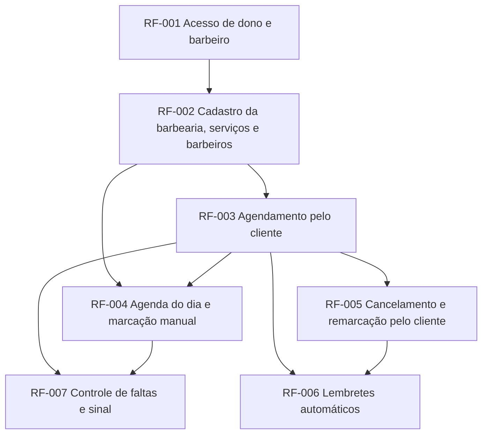

# Roadmap: Agenda da Barbearia

## Como ler este documento
- **Agora**: em execução ou com compromisso firmado para o ciclo atual.
- **Próximo**: priorizado, com PRD em andamento. A ordem pode mudar.
- **Depois**: direção de intenção, sem compromisso de data.
- Itens sem link para PRD ou FDD são ideias, não compromissos.
- Revisado mensalmente. Fora disso, apenas o status dos itens é atualizado.
- "Ordem de execução" é derivada da tabela de dependências do PRD e regenerada por script; não é editada à mão.

## Objetivos do período
| Objetivo | Métrica | Hoje | Meta |
|---|---|---|---|
| Reduzir o não-comparecimento | faltas por semana sobre agendamentos confirmados | 8 a 10 horários vazios por semana | cair pela metade em 3 meses |

## Ordem de execução

Requisitos na mesma onda podem ser construídos em paralelo. Uma onda começa só depois que todos os requisitos das ondas anteriores estão prontos. Gerado por `python3 .claude/skills/docs-init/scripts/prd_checks.py <prd> --ondas`.

### [PRD: Agenda da Barbearia](prd-agenda-barbearia.md)

- **Onda 1**: RF-001
- **Onda 2**: RF-002
- **Onda 3**: RF-003
- **Onda 4**: RF-004, RF-005
- **Onda 5**: RF-006, RF-007

Caminho crítico: RF-001 > RF-002 > RF-003 > RF-005 > RF-006 (5 ondas).

**Nota:** requisitos de fundação (RF-001) não rodam em paralelo em um projeto novo, mesmo quando aparecem juntos em uma onda: eles tocam os mesmos arquivos de base e são implementados em sequência até a base existir.

## Agora
| Iniciativa | Requisitos | Objetivo | Status | Docs | Owner |
|---|---|---|---|---|---|
| Base da agenda | RF-001, RF-002, RF-003 | Fazer o cliente agendar sozinho | em andamento | [PRD](prd-agenda-barbearia.md#rf-001-acesso-de-dono-e-barbeiro) | Maicon Souza |

## Próximo
| Iniciativa | Requisitos | Objetivo | Status | Docs |
|---|---|---|---|---|
| Operação do dia | RF-004, RF-005 | Tirar o dono do atendimento por mensagem | priorizado | [PRD](prd-agenda-barbearia.md#rf-004-agenda-do-dia-e-marcacao-manual) |

## Depois
- Lembretes e controle de faltas (RF-006, RF-007)

## Concluído
| Iniciativa | Entregue em | Docs |
|---|---|---|

## Adiado ou removido
| Iniciativa | Decisão | Motivo | Data |
|---|---|---|---|

## Histórico de mudanças
| Data | Mudança | Por quem |
|---|---|---|
| 2026-10-21 | Criação a partir do PRD | Maicon Souza |
